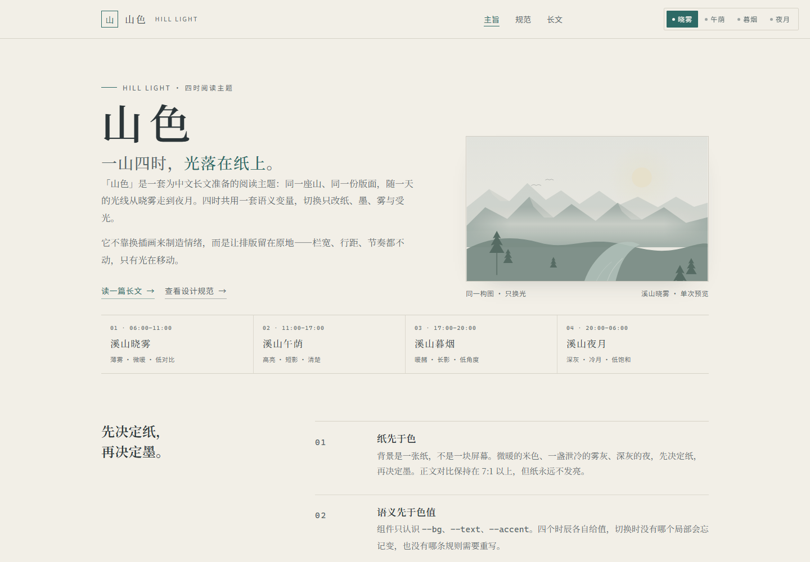

# 山色 · Hill Light

一套给中文长文阅读的四时主题：**同一座山，四种光。**

[在线预览](https://hill-light.github.io/hill-light-theme/) · [设计规范](DESIGN.md) · [长文示例](https://hill-light.github.io/hill-light-theme/demo.html)



## 四个时辰

| Key | 名称 | 时间 | 纸面 | 墨 | 强调 |
| --- | --- | --- | --- | --- | --- |
| `dawn` | 溪山晓雾 | 06:00–10:59 | `#F2EFE7` | `#2B3538` | `#2D6A66` |
| `noon` | 溪山午荫 | 11:00–16:59 | `#FAF6EC` | `#263230` | `#1D6A55` |
| `dusk` | 溪山暮烟 | 17:00–19:59 | `#F1E2D0` | `#3A2C26` | `#35645D` |
| `night` | 溪山夜月 | 20:00–05:59 | `#1B2223` | `#D7DDD9` | `#8CB9AE` |

默认跟随读者本地时间。右上角的四枚按钮可以手动选择，选择会保存在 `localStorage`；`?theme=dawn` 这样的 URL 参数只预览当前这一页，不覆盖已保存的偏好。

同一座山的构图、留白、溪流、松树和飞鸟在四时中完全不变。变的只有色温、对比、雾的厚薄和受光的边缘。

## 快速开始

没有构建步骤。克隆后任意静态服务器即可：

```bash
git clone https://github.com/hill-light/hill-light-theme.git
cd hill-light-theme
python -m http.server 8765
# 打开 http://127.0.0.1:8765/
```

也可以直接双击 `index.html`。没有远程字体、没有框架、没有打包器。

## 页面

- **`index.html`** — 主旨、四时预览入口、同一山水的完整插图。
- **`styleguide.html`** — 四时下的组件、变量标注、晓雾/夜月并排对比开关。
- **`demo.html`** — 约 1,100 字的长文示例，含跟随滚动的目录。

## 用在自己的页面

主题的唯一样式来源是 [`css/tokens.css`](css/tokens.css)。最小用法：

```html
<link rel="stylesheet" href="css/tokens.css">
<link rel="stylesheet" href="css/base.css">
<html data-theme="dawn">
```

`tokens.css` 里 `:root` 即晓雾；`[data-theme="noon|dusk|night"]` 覆盖同一组语义变量。组件只使用 `--bg`、`--text`、`--accent` 这类名称，因此换主题不需要改任何组件规则。

需要自动跟随时间与手动切换时，再加载 `js/theme.js`，并给切换器加上 `data-theme-switcher` 标记；完整结构见 `index.html`。

详细约束（字体、栏宽、对比度、组件禁止项）见 [DESIGN.md](DESIGN.md)。

## 结构

```
.
├── index.html
├── styleguide.html
├── demo.html
├── css/
│   ├── tokens.css       四时色值与所有设计变量
│   ├── base.css         重置、排版、页头页脚、切换器
│   ├── components.css   链接、按钮、引用、代码、表格、山水
│   └── pages.css        三个页面的布局
├── js/theme.js          切换、存储、自动时辰、并排对比
├── art/hill-light.svg   可独立使用的山水 SVG
├── scripts/check-contrast.mjs
└── docs/screenshots/
```

## 校验

```bash
node scripts/check-contrast.mjs
```

脚本解析 `tokens.css`，检查四时里 13 组文字/背景配对：普通文字 ≥ 4.5:1、焦点环 ≥ 3:1。当前全部通过，最低 4.54:1。CI 在每次 push 和 pull request 时运行。

人工检查三档视口：1440×1000、768×900、375×812。375 下导航换到第二行，色板表可横向滚动并有提示。

## Quarto

同一套变量与切换逻辑提供两个 Quarto 集成：

- [hill-light-quarto-book](https://github.com/hill-light/hill-light-quarto-book) — book 模板与扩展
- [hill-light-quarto-website](https://github.com/hill-light/hill-light-quarto-website) — website 模板与扩展

两者都使用格式名 `hill-light-html`。扩展会额外覆盖 Bootstrap 5 / Quarto 的导航、侧栏、代码块与提示块变量。

## 设计原则

- 山是常量，光是变量；切换时不换构图。
- 夜间不用纯黑，正文不用纯白。
- 正文优先：18px、1.75 行高、680px 栏宽，单栏无侧栏。
- 组件只认识语义变量，色值只出现在 `tokens.css`。
- 不打包中文字体，不引入构建工具。
- 动效只发生在颜色上，并尊重 `prefers-reduced-motion`。

## 许可

[MIT](LICENSE) © 2026 chengzhao-dev
