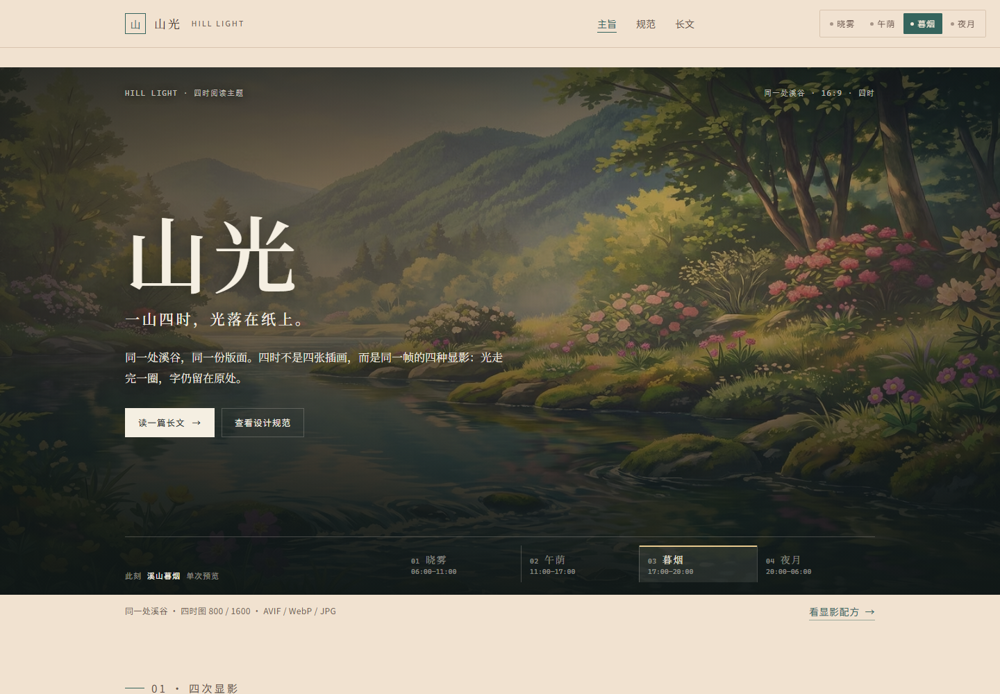

# 山光 · Hill Light

一套给中文长文阅读的四时主题：**同一处溪谷，四次显影。**

[在线预览](https://hill-light.github.io/hill-light-theme/) · [设计规范](DESIGN.md) · [长文示例](https://hill-light.github.io/hill-light-theme/demo.html)



## 四个时辰

| Key | 名称 | 时间 | 纸面 | 墨 | 强调 |
| --- | --- | --- | --- | --- | --- |
| `dawn` | 溪山晓雾 | 06:00–10:59 | `#F2EFE7` | `#2B3538` | `#2D6A66` |
| `noon` | 溪山午荫 | 11:00–16:59 | `#FAF6EC` | `#263230` | `#1D6A55` |
| `dusk` | 溪山暮烟 | 17:00–19:59 | `#F1E2D0` | `#3A2C26` | `#35645D` |
| `night` | 溪山夜月 | 20:00–05:59 | `#1B2223` | `#D7DDD9` | `#8CB9AE` |

默认跟随读者本地时间。右上角的四枚按钮可以手动选择，选择会保存在 `localStorage`。没有保存偏好时，`?theme=dawn` 会预览这一页；已经保存过偏好时，用 `?theme=dawn&preview=1` 强制预览，仍不覆盖已保存的选择。

四时图不是四张不同构图的插画，而是同一张 21:9 母图的四种显影。16:9 与 21:9 都从这张母图取景，远山、水面与花丛的位置不动；变的只有曝光、色温、雾的厚薄、月光的补色和蓝调分离。页面把四时各三层——舞台、16:9 壁纸卡、21:9 壁纸卡——叠在固定位置，切换时只做透明度交叉，所以不会出现取景跳变。

## 快速开始

没有构建步骤。克隆后任意静态服务器即可：

```bash
git clone https://github.com/hill-light/hill-light-theme.git
cd hill-light-theme
python -m http.server 8765
# 打开 http://127.0.0.1:8765/
```

也可以直接双击 `index.html`。没有远程字体、没有框架、没有打包器。

## 页面

- **`index.html`** — 四时大图、四次显影的图行、午荫/夜月对比滑杆、16:9 / 21:9 壁纸区、显影参数表与组织入口。
- **`styleguide.html`** — 四时下的组件、变量标注、晓雾/夜月并排对比开关。
- **`demo.html`** — 约 1,100 字的长文示例，含跟随滚动的目录。

## 用在自己的页面

主题的唯一样式来源是 [`css/tokens.css`](css/tokens.css)。最小用法：

```html
<link rel="stylesheet" href="css/tokens.css">
<link rel="stylesheet" href="css/base.css">
<html data-theme="dawn">
```

`tokens.css` 里 `:root` 即晓雾；`[data-theme="noon|dusk|night"]` 覆盖同一组语义变量。组件只使用 `--bg`、`--text`、`--accent` 这类名称，因此换主题不需要改任何组件规则。

需要自动跟随时间与手动切换时，再加载 `js/theme.js`，并使用带 `.theme-switcher` 类的容器与 `data-theme-choice` 按钮；完整结构见 `index.html`。四时图像层是可选的：给每个 `<picture>` 加 `data-theme-frame="dawn|noon|dusk|night"` 和 `.light-frame` 类，脚本会在切换时同步 `aria-hidden`。

详细约束（字体、栏宽、对比度、组件禁止项）见 [DESIGN.md](DESIGN.md)。

## 结构

```
.
├── index.html
├── styleguide.html
├── demo.html
├── css/
│   ├── tokens.css       四时色值与所有设计变量
│   ├── base.css         重置、排版、页头页脚、切换器
│   ├── components.css   链接、按钮、引用、代码、图像叠色
│   └── pages.css        三个页面的布局
├── js/theme.js          切换、存储、自动时辰、并排滑杆
├── art/hill-light.svg   可独立使用的山水 SVG（Quarto 扩展仍在用）
├── assets/
│   ├── favicon.svg
│   └── img/
│       ├── times/       四时页面图（800/1600 AVIF/WebP/JPG）与 21:9 预览（840/1680）
│       ├── wallpapers/  全尺寸壁纸（1920×1080 与 2520×1080 JPG）
│       └── brand/       组织头像、OG 封面、仓库社交预览、触屏图标
├── scripts/
│   ├── build-art.py     从单张 flower.jpg 生成全部图像
│   ├── check-contrast.mjs
│   └── check-site.mjs   本地引用、图像尺寸与页面结构
└── docs/screenshots/
```

## 生成四时图

把源图放在仓库根目录并命名为 `flower.jpg`，运行：

```bash
python3 scripts/build-art.py
```

也可以显式指定路径：

```bash
python3 scripts/build-art.py --flower /path/to/flower.jpg
```

脚本需要 Pillow 与 numpy。参数集中在 `GRADES` 字典里：线性曝光、白平衡、lift/gamma/对比/饱和、分离色调、雾、辉光、bloom、duotone、压暗天空、月盘、vignette 与颗粒。它从一张 21:9 母图生成四时，再取 16:9 与 21:9 两种画幅：

- `assets/img/times/flower-<theme>-{800,1600}.{avif,webp,jpg}`：800×450 与 1600×900 页面图，由 `srcset` 按视口选择；
- `assets/img/times/wide-<theme>-{840,1680}.{avif,webp,jpg}`：840×360 与 1680×720 宽幅预览；
- `assets/img/wallpapers/hill-light-<theme>-{16x9,21x9}.jpg`：1920×1080 与 2520×1080 壁纸；
- `assets/img/brand/`：组织头像 460×460、180×180 触屏图标、1200×630 OG 封面、1280×640 仓库社交预览。

组织头像从同一幅原画方裁；缩到 64 像素仍能读出山脊、水面与花。源图不随仓库发布。

## 校验

```bash
node scripts/check-contrast.mjs
node scripts/check-site.mjs
```

对比度脚本解析 `tokens.css`，检查四时里 13 组文字/背景配对：普通文字 ≥ 4.5:1、焦点环 ≥ 3:1。当前全部通过，最低 4.54:1。

站点脚本检查三页的本地引用、48 个页面图文件与 8 张壁纸的格式/尺寸、12 个主题图像层、8 个壁纸下载、组织头像与社交封面，以及首屏图片是否 eager。当前通过。CI 在每次 push 和 pull request 时运行两项检查。

人工检查三档视口：1440×1000、768×900、390×844。三档都不得出现横向溢出；390 下导航换行、时间轨变成 2×2、图行改为单列，色板表可横向滚动。

## Quarto

同一套变量与切换逻辑提供两个 Quarto 集成：

- [hill-light-quarto-book](https://github.com/hill-light/hill-light-quarto-book) — book 模板与扩展
- [hill-light-quarto-website](https://github.com/hill-light/hill-light-quarto-website) — website 模板与扩展

两者都使用格式名 `hill-light-html`。扩展会额外覆盖 Bootstrap 5 / Quarto 的导航、侧栏、代码块与提示块变量。Quarto 站点继续使用 `art/hill-light.svg` 的矢量山水，首页的位图显影不参与扩展构建。

## 设计原则

- 同一张母图，16:9 与 21:9 两种画幅；光是变量，构图不动。
- 四时图在构建时生成，不在浏览器里跑滤镜。
- 夜间不用纯黑，正文不用纯白。
- 正文优先：18px、1.75 行高、680px 栏宽，单栏无侧栏。
- 组件只认识语义变量，色值只出现在 `tokens.css`。
- 不打包中文字体，不引入构建工具。
- 动效只发生在颜色与图像透明度上，并尊重 `prefers-reduced-motion`。

## 许可

[MIT](LICENSE) © 2026 chengzhao-dev
